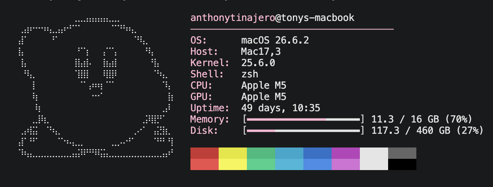

# Kirby macOS System Info

A lightweight, customizable system information CLI for macOS, written in Bash.

Inspired by Kirby, this project features custom Unicode artwork, a pastel pink-and-white color scheme, and a minimal terminal interface.

## Preview



## Features

- Custom Kirby ASCII artwork
- Pastel pink-and-white terminal styling
- Automatic macOS hardware detection
- CPU and GPU information
- Operating system, kernel, and shell details
- System uptime
- Memory and disk usage with progress bars
- Classic terminal color palette

## Installation

Clone the repository:

```bash
git clone https://github.com/YOUR_USERNAME/kirby-macos-system-info.git
```

Navigate to the project directory:

```bash
cd kirby-macos-system-info
```

Run the script:

```bash
bash system-info.sh
```

## Customization

Colors, artwork, and progress bars can be modified directly in `system-info.sh`.

The default accent color is Kirby-inspired pastel pink (`#FFB7D5`).

## Requirements

- macOS
- Bash
- Terminal with ANSI color and Unicode support

## Technical Details

Built using Bash and native macOS utilities, including `sysctl`, `system_profiler`, `vm_stat`, `sw_vers`, and `df`.

No additional packages are required.

---

Written in Bash | Designed for macOS
